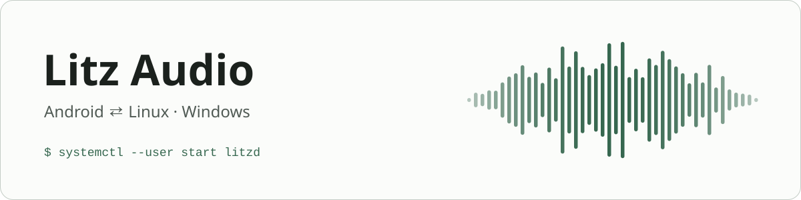
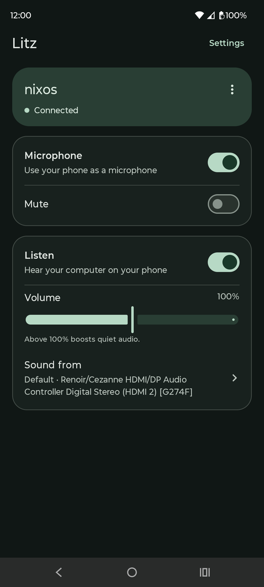
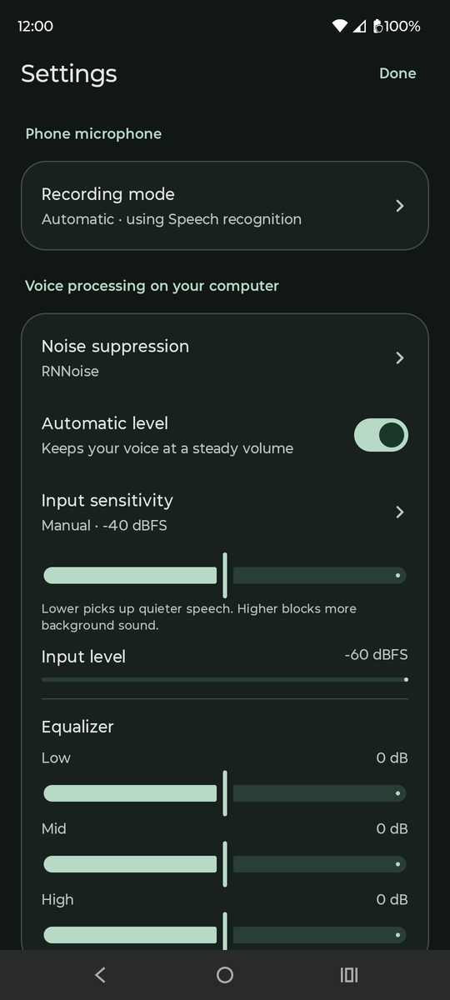

<picture>
  <source media="(prefers-color-scheme: dark)" srcset="docs/images/banner-dark.svg">
  
</picture>

[English](README.md) | Español

Litz convierte tu teléfono Android en un micrófono para tu PC con Linux o Windows. También funciona al revés: puedes escuchar el audio de la computadora en el teléfono. Todo va por tu red local, o por cable USB si lo prefieres.

En la computadora corre un servicio pequeño en segundo plano llamado `litzd`. La app del teléfono lo encuentra y se conecta.

<table align="center">
  <tr>
    <th>Inicio</th>
    <th>Ajustes</th>
  </tr>
  <tr>
    <td></td>
    <td></td>
  </tr>
</table>

Litz todavía es joven y seguramente te vas a topar con errores, sobre todo en Windows. Si pasa, [abre un issue](https://github.com/ArturoAtomplay/litz-audio/issues) (en español está bien).

## Instalación

### Linux

Necesitas PipeWire 1.0 o más reciente, o PulseAudio.

```sh
curl -fsSL https://github.com/ArturoAtomplay/litz-audio/releases/latest/download/install.sh | sh
```

El script instala Litz en `~/.local` y lo arranca cuando inicias sesión. No necesita root.

Si prefieres un paquete, hay `.deb` y `.rpm` en la [página de releases](https://github.com/ArturoAtomplay/litz-audio/releases). Después de instalarlo, arranca el servicio una vez:

```sh
systemctl --user enable --now litzd
```

En NixOS, el flake de este repo trae un módulo: `services.litz-audio.enable = true`.

### Windows

Ejecuta el instalador de la [página de releases](https://github.com/ArturoAtomplay/litz-audio/releases). Para usar el teléfono como micrófono también necesitas [VB-CABLE](https://vb-audio.com/Cable/). Escuchar la PC en el teléfono funciona sin él.

### Android

Instala el APK de la [página de releases](https://github.com/ArturoAtomplay/litz-audio/releases).

## Uso

1. Conecta el teléfono y la computadora a la misma red.
2. Abre Litz en el teléfono y toca tu computadora.
3. En la computadora, haz clic en Allow.

Mientras se vinculan, las dos pantallas muestran el mismo código de seis dígitos. Acepta solo si coinciden. Después de la primera vez, el teléfono se reconecta solo.

En Discord, Zoom o lo que uses para llamadas, elige **Litz Microphone** (Linux) o **CABLE Output** (Windows) como micrófono.

Si el teléfono no ve la computadora, prueba con **Vincular por dirección IP** y revisa que el firewall deje pasar el puerto UDP 47165 y mDNS (UDP 5353). El anclaje USB también funciona. Hay más ayuda en la [guía de solución de problemas](docs/troubleshooting.es.md).

Con el micrófono activado, la PC también oye lo que suene por el altavoz del teléfono. Con audífonos no pasa. Sin ellos, el modo de grabación **Llamadas y reuniones** en Ajustes usa la cancelación de eco del teléfono si la tiene, y Android trata tu voz como en una llamada.

Para ver o quitar teléfonos vinculados desde la computadora, usa `litzd devices` o `litzd forget NOMBRE`.

## Compilar

Necesitas Rust (la versión está fijada en `rust-toolchain.toml`). En Linux también hacen falta los headers de PipeWire y PulseAudio, `pkg-config` y `libclang`. Con Nix, `nix develop` te da todo.

```sh
packaging/fetch-model.sh target/model    # modelo de DeepFilterNet, para los tests
export LITZ_DATA_DIR=$PWD/target/model   # nix develop lo configura por ti
cargo build --release -p litzd
cargo test -p litz-core -p litzd
```

La app de Android está en `android/`. Necesita JDK 17, el SDK y el NDK de Android, y `cargo-ndk`. `nix develop .#android` los configura.

```sh
android/gradlew -p android :app:assembleFossDebug   # sin anuncios ni librerías propietarias
android/gradlew -p android :app:assemblePlayDebug   # versión de Google Play, con anuncios de prueba de Google
```

## Apoyo

Hago Litz en mi tiempo libre. Si te sirve, puedes invitarme un café en [Ko-fi](https://ko-fi.com/arturoatomplay). Lo que llega se va en teléfonos para probar. Reportar errores o contarme cómo funciona en tu dispositivo ayuda igual.

## Licencia

GPL-3.0-or-later, con un permiso adicional para enlazar el SDK de Google Mobile Ads en la versión de Google Play. Ver [LICENSE](LICENSE), [LICENSE-EXCEPTION](LICENSE-EXCEPTION) y [THIRD_PARTY_NOTICES](THIRD_PARTY_NOTICES).

También: [política de privacidad](PRIVACY.md), [reportar una vulnerabilidad](SECURITY.md), [cómo contribuir](CONTRIBUTING.md) (en inglés).
