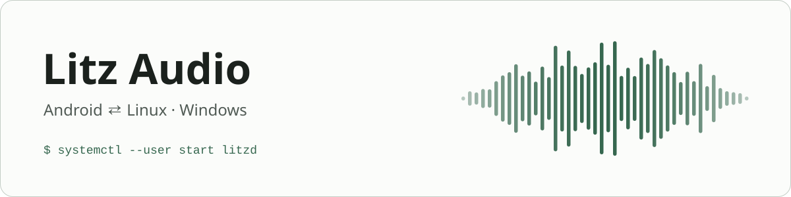
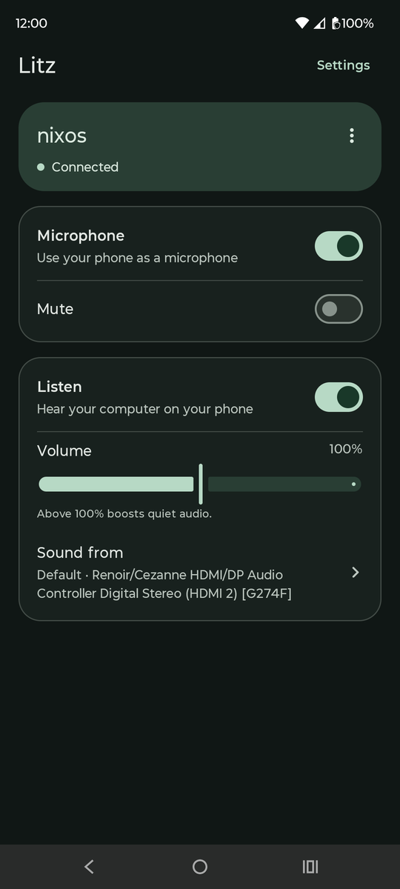
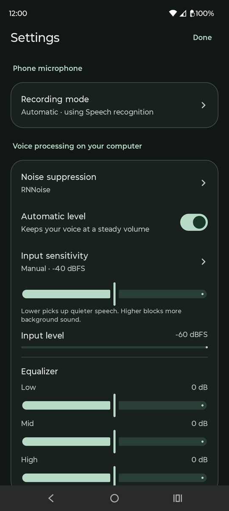

<picture>
  <source media="(prefers-color-scheme: dark)" srcset="docs/images/banner-dark.svg">
  
</picture>

English | [Español](README.es.md)

Litz turns an Android phone into a microphone for a Linux or Windows PC. It also works the other way: you can listen to the computer's audio on the phone. Everything goes over your local network, or a USB cable if you prefer.

On the computer it's a small background service called `litzd`. The phone app finds it and connects.

<table align="center">
  <tr>
    <th>Home</th>
    <th>Settings</th>
  </tr>
  <tr>
    <td></td>
    <td></td>
  </tr>
</table>

Litz is still young and you'll probably hit bugs, more so on Windows. If you do, please [open an issue](https://github.com/ArturoAtomplay/litz-audio/issues).

## Install

### Linux

You need PipeWire 1.0 or newer, or PulseAudio.

```sh
curl -fsSL https://github.com/ArturoAtomplay/litz-audio/releases/latest/download/install.sh | sh
```

The script installs Litz into `~/.local` and starts it when you log in. It doesn't need root.

If you'd rather use a package, there are `.deb` and `.rpm` files on the [releases page](https://github.com/ArturoAtomplay/litz-audio/releases). After installing one, start the service once:

```sh
systemctl --user enable --now litzd
```

On NixOS, the flake in this repo has a module: `services.litz-audio.enable = true`.

### Windows

Run the installer from the [releases page](https://github.com/ArturoAtomplay/litz-audio/releases). To use the phone as a microphone you also need [VB-CABLE](https://vb-audio.com/Cable/). Listening to the PC on the phone works without it.

### Android

Install the APK from the [releases page](https://github.com/ArturoAtomplay/litz-audio/releases).

## Usage

1. Put the phone and the computer on the same network.
2. Open Litz on the phone and tap your computer.
3. Click Allow on the computer.

Both screens show the same six-digit code while pairing. Only allow it if they match. After the first time, the phone reconnects by itself.

In Discord, Zoom or whatever you call with, pick **Litz Microphone** (Linux) or **CABLE Output** (Windows) as the microphone.

If the phone doesn't see the computer, try **Pair by IP address**, and check that your firewall lets through UDP port 47165 and mDNS (UDP 5353). USB tethering works too. More help is in [Troubleshooting](docs/troubleshooting.md).

With the microphone on, the PC also hears whatever comes out of the phone's speaker. Headphones fix that. Without them, the **Calls and meetings** recording mode in Settings uses the phone's echo cancellation if it has one, which makes Android treat your voice like a phone call.

To see or remove paired phones from the computer, run `litzd devices` or `litzd forget NAME` (`litzd forget --all` removes every phone).

## Building

You need Rust (the version is pinned in `rust-toolchain.toml`). On Linux you also need the PipeWire and PulseAudio headers, `pkg-config` and `libclang`. With Nix, `nix develop` gives you all of it.

```sh
packaging/fetch-model.sh target/model    # DeepFilterNet model, for tests
export LITZ_DATA_DIR=$PWD/target/model   # nix develop sets this for you
cargo build --release -p litzd
cargo test -p litz-core -p litzd
```

The Android app lives in `android/`. It needs JDK 17, the Android SDK and NDK, and `cargo-ndk`. `nix develop .#android` sets them up.

```sh
android/gradlew -p android :app:assembleFossDebug   # no ads, no proprietary libraries
android/gradlew -p android :app:assemblePlayDebug   # Google Play version, shows Google test ads
```

## Support

I work on Litz in my spare time. If it's useful to you, you can buy me a coffee on [Ko-fi](https://ko-fi.com/arturoatomplay). The money goes to phones for testing. Bug reports and results from your device help just as much.

## License

GPL-3.0-or-later, with an extra permission to link the Google Mobile Ads SDK in the Google Play version. See [LICENSE](LICENSE), [LICENSE-EXCEPTION](LICENSE-EXCEPTION) and [THIRD_PARTY_NOTICES](THIRD_PARTY_NOTICES).

Also: [privacy policy](PRIVACY.md), [reporting a vulnerability](SECURITY.md), [contributing](CONTRIBUTING.md).
